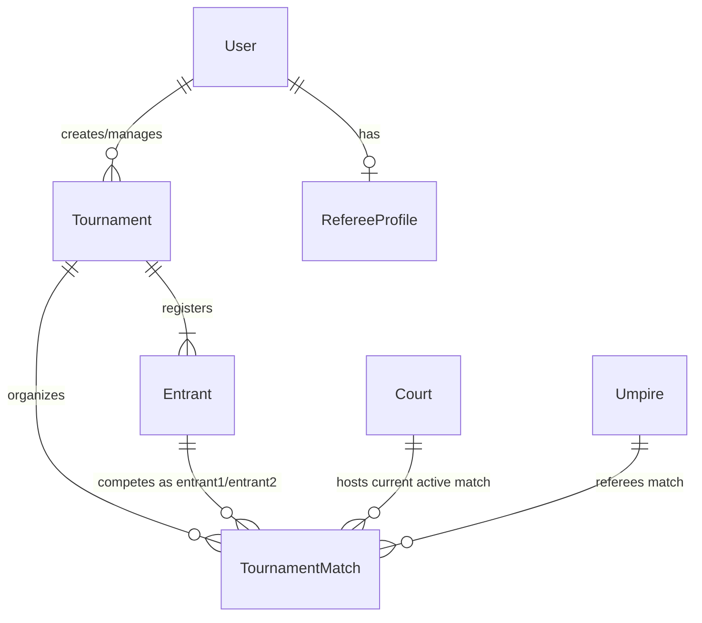
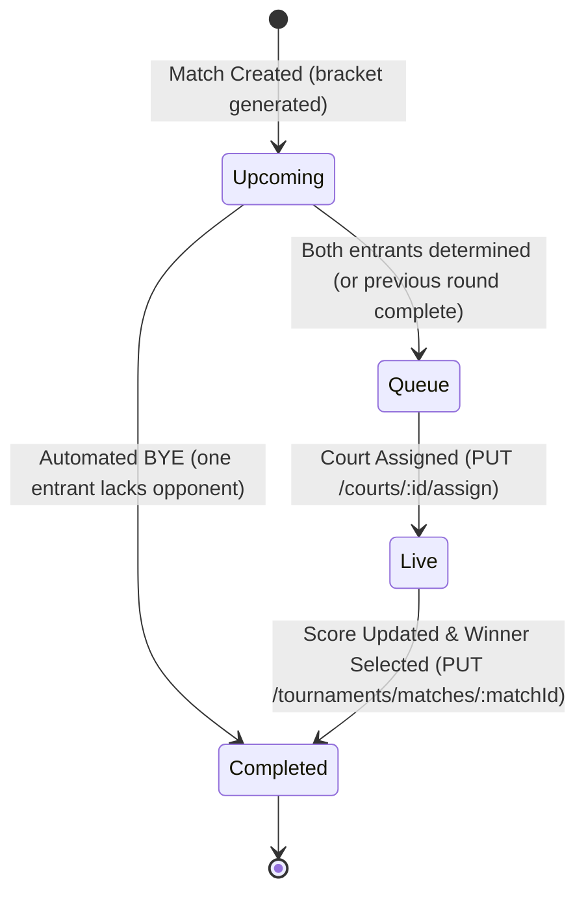
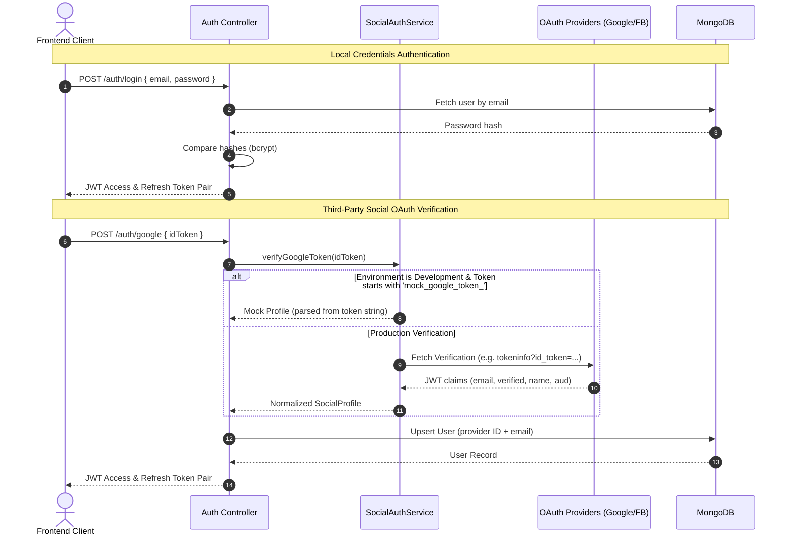

# Scorevant

Scorevant is a professional-grade officiating assistant, tournament management platform, and live scoring system built specifically for modern racket sports. Designed for tournament directors, referees, umpires, players, and spectators, it delivers a premium real-time experience for managing and broadcasting matches across multiple disciplines.

Supporting **Badminton, Tennis, Table Tennis, Squash, and Pickleball**, Scorevant combines tournament administration, intelligent scoring automation, live match tracking, spectator broadcasting, and resilient offline support within a single high-performance ecosystem.

---

## Overview

Scorevant was engineered to solve the operational challenges faced during competitive racket sport events. From generating tournament brackets and managing courts to officiating live matches and broadcasting scores in real time, the platform provides a seamless workflow from tournament setup to final results.

The system is powered by a highly optimized match engine architecture, secure authentication infrastructure, optional realtime synchronization, and a premium accessibility-focused user interface.

---

## Recent Changes

### September 2026

**Frontend & Backend Integration Link**

- **Real-Time Match Sync**: Connected `Scoreboard` scoring engine directly to backend `PUT /tournaments/matches/:matchId`, automatically updating live scores, set progress, and bracket advancement on the server.
- **Public Spectator Streaming**: Created unauthenticated `@Public()` endpoint `@Get('/tournaments/matches/:matchId/public')` in NestJS backend and added live 2-second polling in `useMatchState` so spectators can watch matches in real time.
- **Dashboard Command Center**: Replaced static placeholders on `/dashboard` with live React Query hooks querying `api.tournaments.list()` and `api.courts.list()`, displaying live active event counts and court statuses.
- **Bracket Winner Propagation**: Integrated entrant IDs (`entrant1Id`, `entrant2Id`) into match setup and automatic bracket winner advancement in `tournament.service.ts` upon match completion.
- **CORS & Resilience**: Normalized `VITE_API_BASE_URL` with trailing-slash handling, added automatic `401 Unauthorized` refresh-token retry in `fetchWithAuth`, and expanded CORS allowed origins for local Vite dev and preview servers.

---

### July 2026

**Authentication & Security Enhancements**

- Implemented JWT refresh token flow for improved session management
- Added refresh token storage and automatic token renewal
- Integrated backend logout API endpoint for secure session termination
- Removed Apple OAuth support (not supported by backend)
- Updated AuthContext to handle refresh tokens and logout API calls

**User Profile System**

- Added comprehensive user profile management
- Created profile editing form with validation
- Implemented user preferences and settings
- Added profile statistics display component
- Created public profile viewing capability
- Added user API service layer for profile operations

**Landing Page Enhancements**

- Added detailed sport documentation modals for Tennis, Badminton, and Table Tennis
- Implemented comprehensive rules, equipment, and scoring information for each sport
- Added interactive sport cards with click-to-view documentation
- Fixed navbar and hero section width alignment with features section
- Improved modal scrolling with proper flexbox layout

**Project Structure Updates**

- Updated all page imports to match feature-based folder structure
- Fixed import paths in App.tsx to use `/index` pattern
- Ensured consistent routing across all pages

**API Client Updates**

- Added health check endpoint for backend service monitoring
- Verified all authentication endpoints match backend specification
- Verified all tournament endpoints match backend specification
- Verified all court endpoints match backend specification
- Confirmed frontend API client is fully compatible with backend

---

## Key Features

### Match Engine Architecture

At the core of Scorevant is a robust pure-function rules engine integrated with a `useReducer` state machine.

The engine accurately handles sport-specific scoring systems including:

- Tennis Deuce and Advantage logic
- Tiebreak scoring
- Rally scoring formats
- Badminton point-cap rules
- Table Tennis match progression
- Squash and Pickleball scoring variations

Key benefits include:

- Deterministic state transitions
- Instant O(1) undo and rollback operations
- Zero known scoring edge-case failures
- Fully predictable match history reconstruction
- Offline-safe state recovery

---

### Secure Authentication

Scorevant includes a complete authentication layer powered by NestJS.

Features include:

- User registration and login
- JWT-based authentication with access and refresh tokens
- bcrypt password hashing
- Protected API endpoints
- User profile retrieval
- Secure session persistence
- Social OAuth integration (Google, Apple)
- Mock token support for development testing

Available endpoints:

```http
POST /auth/register
POST /auth/login
POST /auth/google
POST /auth/apple
POST /auth/refresh
POST /auth/logout
GET  /auth/me
```

All protected requests automatically include JWT authorization tokens through the frontend API layer.

---

### Tournament Management

The platform supports complete tournament lifecycle management.

Administrators can:

- Create tournaments
- Register participants
- Seed players
- Generate brackets
- Assign courts (with optional court selection during creation)
- Manage match queues
- Launch officiated matches directly from bracket views
- Track tournament progression in real time

All tournament operations are powered by a NestJS backend and React Query-powered frontend architecture.

---

### Court Management

The Live Courts feature provides real-time court status tracking and match assignment capabilities.

Features include:

- Create and manage multiple courts
- View court status (Idle/In Use)
- Assign matches from queue to available courts
- Free courts after match completion
- Real-time status updates with 3-second polling
- Match queue management for pending assignments

---

### Spectator Display Mode

A dedicated spectator experience allows matches to be broadcast on large screens, mobile devices, or remote viewing stations.

Officials can simply:

1. Open a live match
2. Select **Copy Live Link**
3. Share the generated URL

The spectator view automatically reflects ongoing score updates and match events.

---

### Match History

Scorevant maintains a comprehensive match history for all completed matches.

Features include:

- Automatic match saving after completion
- Persistent storage using local storage
- Match details including players, scores, sets breakdown
- Sport type and date tracking
- Winner identification with trophy indicators
- Clear history functionality
- Historical data accessible from dedicated history page

---

### Offline Persistence & Recovery

Tournament environments are not always connected.

To ensure uninterrupted operation, Scorevant provides automatic persistence using local storage fallbacks.

Benefits include:

- Recovery after accidental tab closure
- Network interruption resilience
- Automatic state restoration
- Seamless continuation of active matches
- Reduced risk of scoring data loss

---

### Accessibility First

Accessibility is treated as a core platform requirement rather than an afterthought.

Implemented features include:

- High Contrast Mode detection
- Reduced Motion support
- Screen reader optimization
- Keyboard navigation support
- Accessible modal focus trapping
- Adaptive visual fallbacks

When users enable high-contrast preferences at the operating system level, advanced visual effects such as glassmorphism are automatically replaced with accessibility-friendly alternatives.

---

### Premium Interface Design

Scorevant utilizes a bespoke **Liquid Gold Design System** focused on clarity, responsiveness, and visual prestige.

Interface highlights include:

- Glassmorphic surfaces
- Fluid page transitions
- Magnetic interactive controls
- Cinematic motion design
- Responsive layouts
- Performance-optimized animations
- Interactive parallax environments

All animations gracefully degrade when reduced-motion preferences are detected.

---

# Technology Stack

## Frontend

| Category         | Technology               |
| ---------------- | ------------------------ |
| Framework        | React 19 + Vite          |
| Language         | TypeScript               |
| State Management | React Hooks + useReducer |
| Data Fetching    | React Query (TanStack)   |
| Styling          | Tailwind CSS v4          |
| Animations       | Framer Motion            |
| Icons            | Lucide React             |
| Routing          | Wouter                   |
| Forms            | React Hook Form          |
| UI Components    | Radix UI + shadcn/ui     |
| Date Handling    | date-fns                 |

---

## Backend

> [!NOTE]
> The NestJS backend code has been moved to a separate repository. This repository now contains the frontend code only, which communicates with the backend via REST API endpoints.

| Category          | Technology     |
| ----------------- | -------------- |
| Framework         | NestJS         |
| Database          | MongoDB        |
| ODM               | Mongoose       |
| Authentication    | JWT + Passport |
| Password Security | bcrypt         |

---

# Project Structure

```text
.
├── src/                          # React 19 + Vite frontend source code
│   ├── components/               # Reusable UI components
│   │   ├── ui/                   # shadcn/ui components (60+ components)
│   │   │   ├── button.tsx
│   │   │   ├── card.tsx
│   │   │   ├── dialog.tsx
│   │   │   ├── form.tsx
│   │   │   ├── input.tsx
│   │   │   ├── select.tsx
│   │   │   └── ... (60+ components)
│   │   ├── MatchHistoryPanel.tsx
│   │   ├── MotionWrappers.tsx
│   │   └── SmoothScroll.tsx
│   ├── contexts/                 # React Context providers
│   │   └── AuthContext.tsx
│   ├── hooks/                    # Custom React hooks
│   │   ├── use-mobile.tsx
│   │   ├── use-toast.ts
│   │   ├── useMatchHistory.ts
│   │   └── useMatchState.ts
│   ├── lib/                      # Utility libraries
│   │   ├── api.ts                # API client and endpoints
│   │   ├── auth-api.ts           # Authentication utilities
│   │   ├── core/                 # Core utilities
│   │   ├── design-system.ts      # Design system configuration
│   │   ├── scoring.ts            # Sport-specific scoring logic
│   │   └── utils.ts              # General utilities
│   ├── pages/                    # Page components (feature-based structure)
│   │   ├── auth/                 # Authentication pages
│   │   │   ├── login/
│   │   │   │   └── index.tsx
│   │   │   └── register/
│   │   │       └── index.tsx
│   │   ├── dashboard/
│   │   │   └── index.tsx         # User dashboard
│   │   ├── documentation/
│   │   │   └── index.tsx         # Documentation page
│   │   ├── history/
│   │   │   └── index.tsx         # Match history page
│   │   ├── home/
│   │   │   └── index.tsx         # Match setup page
│   │   ├── landing/
│   │   │   └── index.tsx         # Landing page
│   │   ├── live-courts/
│   │   │   └── index.tsx         # Court management page
│   │   ├── scoreboard/
│   │   │   └── index.tsx         # Live scoring page
│   │   ├── spectate/
│   │   │   └── index.tsx         # Spectator view page
│   │   ├── tournament-details/
│   │   │   └── index.tsx         # Tournament details page
│   │   ├── tournaments/
│   │   │   └── index.tsx         # Tournament management page
│   │   └── not-found/
│   │       └── index.tsx         # 404 page
│   ├── types/                    # TypeScript type definitions
│   ├── assets/                   # Static assets (images, etc.)
│   ├── App.tsx                   # Main app component with routing
│   ├── main.tsx                  # Application entry point
│   └── index.css                 # Global styles
├── public/                       # Static assets
│   └── brand/                    # Brand assets (logos, etc.)
├── Intructions/                  # Development guidelines
│   └── DESIGN_iNSTRUCTIONS.md    # Mandatory design instructions
├── .env                          # Environment variables (not in git)
├── .env.example                 # Example environment variables
├── .gitignore                   # Git ignore rules
├── components.json              # shadcn/ui configuration
├── package.json                 # Dependencies and scripts
├── tsconfig.json                # TypeScript configuration
├── tsconfig.node.json           # TypeScript config for Node
├── vite.config.ts               # Vite build configuration
├── vercel.json                  # Vercel deployment configuration
└── README.md                    # This file
```

---

# Available Scripts

| Command             | Description                                              |
| ------------------- | -------------------------------------------------------- |
| `npm start`         | Start the development server (alias for `npm run dev`)   |
| `npm run dev`       | Start the Vite development server on `0.0.0.0`           |
| `npm run build`     | Build the application for production                     |
| `npm run preview`   | Preview the production build locally                     |
| `npm run serve`     | Serve the production build (alias for `npm run preview`) |
| `npm run typecheck` | Run TypeScript type checking without emitting files      |

---

# Getting Started

## Prerequisites

Before running the project, ensure you have:

- Node.js v20 or newer
- npm or yarn package manager
- An active backend server running (either locally from the backend repository or deployed online)

---

## Installation & Setup

1. **Clone the repository:**

   ```bash
   git clone <repository-url>
   cd Scorevant-Frontend
   ```

2. **Install dependencies:**

   ```bash
   npm install
   ```

3. **Configure environment variables:**
   Create a `.env` file in the root directory based on `.env.example`:
   ```env
   VITE_API_BASE_URL=http://localhost:3000
   ```
   Replace `http://localhost:3000` with your backend server URL.

---

## Running the Application

Start the frontend development server:

```bash
npm start
# or
npm run dev
```

The application will be available at `http://localhost:5173` (or the port shown in the terminal).

---

## Building for Production

Create an optimized production build:

```bash
npm run build
```

The build artifacts will be stored in the `dist/` directory.

---

# Backend API Documentation

The Scorevant frontend communicates with a NestJS REST API backend. The backend repository contains the complete API implementation with authentication, tournament management, and court allocation systems.

## Key Backend Features

- **Secure Multitenant Authentication**: Traditional credentials-based signup/login powered by `bcrypt` & JWT, paired with Google and Apple OAuth validations
- **Dynamic Single-Elimination Brackets**: Automatic seed-based bracket generator supporting automated BYE propagation and dynamic winner advancement
- **Real-time Court Allocation & Queuing**: Active court assignment flows and matching buffers to optimize court utilization
- **Hardened Enterprise Security**: Security headers handled via `helmet`, CORS configurations, and rate-limiting throttlers

## Authentication System

The backend supports multiple authentication methods:

### Traditional Credentials

- **Register**: `POST /auth/register` with `{ email, password, fullName }`
- **Login**: `POST /auth/login` with `{ email, password }`
- **Refresh Token**: `POST /auth/refresh` with `{ refreshToken }`
- **Logout**: `POST /auth/logout` (requires Bearer JWT)
- **Get Current User**: `GET /auth/me` (requires Bearer JWT)

### Social OAuth

- **Google SSO**: `POST /auth/google` with `{ idToken }`
- **Apple SSO**: `POST /auth/apple` with `{ idToken }`

### Mock Token Testing (Development Mode)

In development environments, you can simulate social SSO without external providers:

- **Google**: Provide `idToken` matching pattern `mock_google_token_<email>_<URI_encoded_fullName>`
  - Example: `mock_google_token_john.doe@gmail.com_John%20Doe`
- **Apple**: Provide `idToken` matching pattern `mock_apple_token_<email>_<URI_encoded_fullName>`

## Tournament Engine API

All `/tournaments` endpoints require authentication via a valid `Bearer JWT` token.

| Method | Endpoint                            | Description                                    | Payload                                                     |
| :----- | :---------------------------------- | :--------------------------------------------- | :---------------------------------------------------------- |
| `POST` | `/tournaments`                      | Create tournament with custom entrants         | `{ name, sportType, maxSets, entrants: [{ name, seed? }] }` |
| `GET`  | `/tournaments`                      | Fetch tournaments created by current user      | None                                                        |
| `GET`  | `/tournaments/:id`                  | Get tournament details, entrants, and brackets | None                                                        |
| `POST` | `/tournaments/:id/generate-bracket` | Generate single-elimination tournament bracket | None                                                        |
| `PUT`  | `/tournaments/matches/:matchId`     | Update scores, status, or finalize winner      | `{ score?, winnerId?, status? }`                            |

## Court & Queue Management API

| Method | Endpoint             | Description                                                        | Payload       |
| :----- | :------------------- | :----------------------------------------------------------------- | :------------ |
| `POST` | `/courts`            | Register a new court at the venue                                  | `{ name }`    |
| `GET`  | `/courts`            | Get all registered courts and their occupancies                    | None          |
| `GET`  | `/courts/queue`      | Get matches waiting for court allocation                           | None          |
| `PUT`  | `/courts/:id/assign` | Assign match to court (updates Court to `In Use`, Match to `Live`) | `{ matchId }` |
| `PUT`  | `/courts/:id/free`   | Complete/suspend match and set court to `Idle`                     | None          |

## Authorization Architecture

Scorevant implements a **Tournament-Scoped Role Model**:

- **Spectator (Default)**: Read-only access to tournaments, brackets, live matches, courts, and standings
- **Tournament Admin (Owner)**: Full control over specific tournament (generate brackets, start matches, assign courts, update scores)

When a user creates a tournament, they automatically become the **Owner/Admin** of that specific tournament. Endpoints modifying tournament state require the user to be a Tournament Admin.

## Match Lifecycle State Machine

A tournament match undergoes a strict state transition flow:

```
[*] → Upcoming → Queue → Live → Completed → [*]
```

- **Upcoming**: Match created (bracket generated)
- **Queue**: Both entrants determined (or previous round complete)
- **Live**: Court assigned (PUT /courts/:id/assign)
- **Completed**: Score updated & winner selected (PUT /tournaments/matches/:matchId)

## Backend Setup

### Prerequisites

- **Node.js**: v20 or newer
- **MongoDB**: Local server `mongodb://127.0.0.1:27017/` or MongoDB Atlas URI

### Environment Variables (.env)

```env
PORT=3000
MONGODB_URI=mongodb://127.0.0.1:27017/scorevant
JWT_SECRET=your-super-secure-secret-key-at-least-32-chars
NODE_ENV=development

# Optional Social OAuth Client Credentials
GOOGLE_CLIENT_ID=your-google-client-id
APPLE_CLIENT_ID=your-apple-client-id
```

### Installation & Running

```bash
npm install
npm run start:dev    # Development watch mode
npm run build        # Build for production
npm run start:prod   # Run production artifact
```

---

# Frontend API Client

The frontend uses a centralized API client located in `src/lib/api.ts` and authentication utilities in `src/lib/auth-api.ts`.

## Authentication Flow

The authentication system supports:

- Traditional email/password login and registration
- Google OAuth integration
- Apple OAuth integration
- JWT access and refresh token management
- Automatic token refresh on expiration

### Token Management

- Access tokens are stored in `localStorage` as `access_token`
- Refresh tokens are stored in `localStorage` as `refresh_token`
- All protected API calls automatically include the Bearer token
- Logout calls the backend endpoint to invalidate the refresh token

## API Client Structure

```typescript
// src/lib/api.ts
export const api = {
  health: async () => {
    /* Health check */
  },
  tournaments: {
    list: async () => {
      /* Get user's tournaments */
    },
    create: async (data) => {
      /* Create tournament */
    },
    getDetails: async (id) => {
      /* Get tournament details */
    },
    generateBracket: async (id) => {
      /* Generate bracket */
    },
    updateMatch: async (matchId, data) => {
      /* Update match */
    },
  },
  courts: {
    list: async () => {
      /* Get all courts */
    },
    create: async (name) => {
      /* Create court */
    },
    getQueue: async () => {
      /* Get match queue */
    },
    assignMatch: async (courtId, matchId) => {
      /* Assign match */
    },
    freeCourt: async (courtId) => {
      /* Free court */
    },
  },
};
```

---

# Pages & Routes

| Route              | Page              | Description                    | Authentication |
| ------------------ | ----------------- | ------------------------------ | -------------- |
| `/`                | Landing           | Landing page with hero section | Public         |
| `/login`           | Login             | User login form                | Public         |
| `/register`        | Register          | User registration form         | Public         |
| `/dashboard`       | Dashboard         | User dashboard                 | Protected      |
| `/setup`           | Home              | Match setup page               | Protected      |
| `/scoreboard`      | Scoreboard        | Live scoring interface         | Protected      |
| `/history`         | History           | Match history archive          | Public         |
| `/tournaments`     | Tournaments       | Tournament management          | Protected      |
| `/tournaments/:id` | TournamentDetails | Tournament bracket view        | Protected      |
| `/courts`          | LiveCourts        | Court management               | Protected      |
| `/spectate/:id`    | Spectate          | Spectator view for matches     | Public         |
| `/docs`            | Documentation     | Documentation page             | Public         |

---

# Key Components

## Custom Hooks

- **useMatchState**: Manages match state with sport-specific scoring logic
- **useMatchHistory**: Handles match history persistence and retrieval
- **useToast**: Toast notification management
- **useMobile**: Mobile device detection

## Core Libraries

- **api.ts**: Centralized API client with authentication
- **auth-api.ts**: JWT token management and storage
- **scoring.ts**: Sport-specific scoring algorithms
- **design-system.ts**: Design system configuration and utilities

## UI Components

The project uses shadcn/ui components with custom styling. Key components include:

- **Button**: Styled buttons with variants
- **Card**: Card containers for content grouping
- **Dialog**: Modal dialogs
- **Form**: Form components with validation
- **Input**: Text input fields
- **Select**: Dropdown selection
- **Toast**: Notification toasts
- **LoadingScreen**: Loading state display

---

# Verification Checklist

After setup:

1. Ensure your backend server is running
2. Start the frontend application with `npm start`
3. Open the application in your browser at `http://localhost:5173`
4. Create a new account using the registration form
5. Sign in with your credentials
6. Confirm redirection to the dashboard
7. Navigate to the Tournaments page
8. Create a new tournament with entrants
9. Optionally select a court during tournament creation
10. Generate the tournament bracket
11. Launch a match and validate scoring functionality
12. Test spectator mode and live-link sharing
13. Verify match history is saved after completing a match
14. Test court management features

---

# Troubleshooting

### Login Displays "Failed to Fetch"

Verify:

- The backend server is running and accessible
- The `VITE_API_BASE_URL` in `.env` correctly points to your backend server URL
- Port `3000` (or whichever port your backend uses) is accessible and not blocked by a firewall

### Build Errors

If you encounter build errors during `npm run build`:

- Clear the node_modules and reinstall: `rm -rf node_modules && npm install`
- Clear the Vite cache `rm -rf .vite && npm run build`
- Ensure TypeScript is properly configured

### MongoDB Database Naming Issues

Windows environments may behave differently with inconsistent database naming.

Use a single database name consistently:

```env
SCOREVANT
```

### Port Already in Use

If port `5173` is already in use:

- The dev server will automatically use the next available port
- Or specify a different port in `vite.config.ts`

---

# Deployment

## Vercel Deployment

The project includes a `vercel.json` configuration file for easy deployment to Vercel.

1. Connect your repository to Vercel
2. Set the `VITE_API_BASE_URL` environment variable in Vercel settings
3. Deploy automatically on push to main branch

## Environment Variables

Required environment variables:

- `VITE_API_BASE_URL`: URL of your backend API server

---

# Design System

### Liquid Gold

| Property           | Value                 |
| ------------------ | --------------------- |
| Primary Color      | `#F4C542`             |
| Background         | `#000000`             |
| Accent Style       | Liquid Gold           |
| Motion System      | Physics-Based Springs |
| Accessibility Mode | Automatic Adaptation  |

### Visual Principles

- Premium competitive sports aesthetic
- Minimal latency perception
- Accessibility-first interactions
- Responsive by default
- Motion with graceful degradation
- High readability under tournament conditions

---

<!-- # Development Guidelines

## Design Instructions

The project follows mandatory design instructions and development restrictions outlined in `Intructions/DESIGN_iNSTRUCTIONS.md`. Key guidelines include:
<!--
### Mandatory Design Instructions
- Follow a premium, minimalist, professional UI
- Maintain consistent spacing using an 8px grid
- Use a single design system across all screens
- Mobile-first responsive layouts
- Accessibility (WCAG 2.2 AA): keyboard navigation, focus states, sufficient contrast
- Support reduced-motion preferences
- Dark theme by default with consistent typography
- Use reusable components; avoid duplicated UI
- Forms must provide inline validation and meaningful error messages
- Loading, empty, success, and error states are mandatory
- Optimize for performance: lazy loading, code splitting, memoization where appropriate
- Strong TypeScript typing; avoid `any`
- Follow feature-based folder structure
- Secure authentication flows and protected routes
- REST APIs must be centralized behind a service layer
- Consistent animations (150–300ms) with graceful degradation
- Offline resilience where applicable
- Every page must have responsive behavior from 320px to 4K --> -->

<!-- ### Development Restrictions
- Do not introduce inconsistent colors, fonts, or spacing
- Do not hardcode API URLs, credentials, or secrets
- Do not bypass authentication or authorization
- Do not duplicate business logic
- Do not manipulate DOM directly when framework abstractions exist
- Do not use inline styles except for dynamic calculations
- Do not use deprecated libraries or unstable packages
- Do not commit `.env`, secrets, API keys, or build artifacts
- Do not ignore accessibility requirements
- Do not disable TypeScript or linting rules to silence errors
- Do not merge untested code
- Avoid unnecessary re-renders and blocking operations
- Never sacrifice correctness for animations or visual effects
- Preserve backward compatibility for public APIs unless versioned
- All new features must include documentation and basic tests

--- -->

# Contributing

Contributions are welcome! Please follow these guidelines:

1. Fork the repository
2. Create a feature branch
3. Make your changes with clear commit messages
4. Ensure all tests pass
5. Submit a pull request

---

# Vision

Scorevant aims to become the definitive digital officiating and tournament operations platform for racket sports. By combining intelligent match management, professional-grade officiating tools, resilient offline support, realtime broadcasting, and a modern user experience, it provides everything required to run competitive events with confidence and precision.

# 🏸 Scorevant Backend API

Scorevant is a high-performance, professional-grade tournament administration platform, officiating assistant, and real-time live scoring system built specifically for modern racket sports: **Badminton, Tennis, Table Tennis, Squash, and Pickleball**.

This repository houses the high-availability **NestJS REST API** that orchestrates the data models, matches brackets generation, and courts queuing systems powering the Scorevant ecosystem.

---

## 🚀 Key System Features

- 🔐 **Secure Multitenant Authentication**: Traditional credentials-based signup/login powered by `bcrypt` & JWT, paired with Google and Facebook OAuth validations.
- 🏆 **Dynamic Single-Elimination Brackets**: Automatic seed-based bracket generator supporting automated BYE propagation and dynamic winner advancement.
- 🏸 **Real-time Court Allocation & Queuing**: Active court assignment flows and matching buffers to optimize court utilization.
- 🛡️ **Hardened Enterprise Security**: Security headers handled via `helmet`, Cross-Origin Resource Sharing (CORS) configurations, and rate-limiting throttlers protect the API against malicious vectors.

---

## 📐 Architecture & System Design

The Scorevant Backend is built around NestJS modules and leverages MongoDB (via Mongoose) to represent data relationally through referenced object IDs.

### Entity-Relationship Diagram



### Match Lifecycle State Machine

A tournament match undergoes a strict state transition flow managed dynamically by the court controller and tournament engine:



### Authentication Flows

Scorevant supports traditional credentials-based login as well as third-party single-sign-on (SSO). To facilitate local development, custom Mock OAuth tokens can be sent directly to the server.



---

## 🛡️ Authorization Architecture

Scorevant implements a **Tournament-Scoped Role Model** rather than global roles. This ensures permissions are strictly isolated to the tournaments a user manages or participates in.

### Roles

1. **Spectator (Default)**: Has read-only access. Can view tournaments, brackets, live matches, courts, and standings.
2. **Tournament Admin (Owner)**: Has full control over a specific tournament. Can generate brackets, start matches, assign courts, and update scores.

### Authorization Flow

- Every registered user starts as a **Spectator**.
- When a user creates a tournament, they automatically become the **Owner/Admin** of that specific tournament.
- The `TournamentAdminGuard` reads the user's JWT and checks if their ID matches the tournament's `ownerId` or exists in the `admins` array.
- Endpoints modifying tournament state (generating brackets, updating scores, assigning courts) require the user to be a Tournament Admin.

---

## 🔌 API Endpoints Reference

### 🩺 System & Health

| Method | Endpoint  | Description                      | Payloads / Query Parameters | Authentication |
| :----- | :-------- | :------------------------------- | :-------------------------- | :------------- |
| `GET`  | `/health` | Core service ping / health check | None                        | None           |

---

### 🔐 Authentication System (`/auth`)

| Method | Endpoint         | Description             | Payloads / Query Parameters                                | Authentication |
| :----- | :--------------- | :---------------------- | :--------------------------------------------------------- | :------------- |
| `POST` | `/auth/register` | Sign up a new user      | `{ "email": "...", "password": "...", "fullName": "..." }` | None           |
| `POST` | `/auth/login`    | Log in and receive JWTs | `{ "email": "...", "password": "..." }`                    | None           |
| `POST` | `/auth/google`   | Google SSO login        | `{ "idToken": "..." }`                                     | None           |
| `POST` | `/auth/facebook` | Facebook SSO login      | `{ "accessToken": "..." }`                                 | None           |

| `POST` | `/auth/refresh` | Issue new access tokens | `{ "refreshToken": "..." }` | None |
| `POST` | `/auth/logout` | Log out and clear refresh token | None | Bearer JWT |
| `GET` | `/auth/me` | Retrieve profile information | None | Bearer JWT |

---

### 👤 Users & Profile Management (`/users`)

_All `/users` endpoints require authentication via a valid `Bearer JWT` token, except for fetching public profiles._

| Method  | Endpoint           | Description                                                                    | Payloads / Query Parameters                                               |
| :------ | :----------------- | :----------------------------------------------------------------------------- | :------------------------------------------------------------------------ |
| `GET`   | `/users/profile`   | Retrieve the authenticated user's full profile including stats and preferences | None                                                                      |
| `PATCH` | `/users/profile`   | Update user profile details (avatar, bio, location, preferences, etc.)         | `{ "username": "...", "bio": "...", "preferences": { "theme": "dark" } }` |
| `GET`   | `/users/:username` | View a public profile based on username (respects `profileVisibility` setting) | `username` (URL parameter)                                                |

---

### 🏆 Tournament Engine (`/tournaments`)

_All `/tournaments` endpoints require authentication via a valid `Bearer JWT` token._

| Method | Endpoint                            | Description                                                                 | Payloads / Query Parameters                                                                                                                  |
| :----- | :---------------------------------- | :-------------------------------------------------------------------------- | :------------------------------------------------------------------------------------------------------------------------------------------- |
| `POST` | `/tournaments`                      | Create a tournament with custom entrants                                    | `{ "name": "Summer Open", "sportType": "Badminton", "maxSets": 3, "entrants": [{ "name": "Player A", "seed": 1 }, { "name": "Player B" }] }` |
| `GET`  | `/tournaments`                      | Fetch tournaments created by the current user                               | None                                                                                                                                         |
| `GET`  | `/tournaments/:id`                  | Get details, entrants, and generated brackets for a tournament              | `id` (Tournament ID parameter)                                                                                                               |
| `POST` | `/tournaments/:id/generate-bracket` | Clear matches and build single-elimination tournament bracket               | `id` (Tournament ID parameter)                                                                                                               |
| `PUT`  | `/tournaments/matches/:matchId`     | Update scores, status, or finalize winner (triggers next-round progression) | `{ "score": { "set1": [21, 15] }, "status": "Live", "winnerId": "..." }`                                                                     |

---

### 🏸 Court & Queue Management (`/courts`)

| Method | Endpoint             | Description                                                            | Payloads / Query Parameters                            | Authentication |
| :----- | :------------------- | :--------------------------------------------------------------------- | :----------------------------------------------------- | :------------- |
| `POST` | `/courts`            | Register a new court at the venue                                      | `{ "name": "Court A" }`                                | Bearer JWT     |
| `GET`  | `/courts`            | Get all registered courts and their occupancies                        | None                                                   | Bearer JWT     |
| `GET`  | `/courts/queue`      | Get matches waiting for court allocation (sorted chronologically)      | None                                                   | Bearer JWT     |
| `PUT`  | `/courts/:id/assign` | Match assignment (updates Court state to `In Use` and Match to `Live`) | `{ "matchId": "..." }` (URL parameter `id` = Court ID) | Bearer JWT     |
| `PUT`  | `/courts/:id/free`   | Complete/suspend match and set court state to `Idle`                   | `id` (Court ID parameter)                              | Bearer JWT     |

---

## 🛠️ Local Installation & Development Setup

### Prerequisites

- **Node.js**: v20 or newer
- **MongoDB**: A running local server `mongodb://127.0.0.1:27017/` or MongoDB Atlas URI

### Configuration File (`.env`)

Create a `.env` file in the project root:

```env
PORT=3000
MONGODB_URI=mongodb+srv://<username>:<password>@cluster.mongodb.net/scorevant?retryWrites=true&w=majority
JWT_SECRET=your-jwt-secret-at-least-32-chars
NODE_ENV=development

# Frontend URL configuration for CORS fallback
FRONTEND_URL=http://localhost:5173
# Comma-separated list of additional allowed origins for CORS (optional)
ALLOWED_ORIGINS=

# Social Authentication Client Credentials (Optional - for validation)
GOOGLE_CLIENT_ID=your-google-client-id
APPLE_CLIENT_ID=your-apple-client-id
FACEBOOK_APP_ID=your-facebook-app-id
```

### Installation

1. Install all system dependencies:

   ```bash
   npm install
   ```

2. Spin up the server in development watch mode:

   ```bash
   npm run start:dev
   ```

3. Build the application for production deployment:

   ```bash
   npm run build
   ```

4. Run the production artifact:
   ```bash
   npm run start:prod
   ```

<!-- ---

## 🧪 Social Login Mock Token Testing (Development Mode)

In development environments (`NODE_ENV=development`), you can simulate social SSO without interacting with external identity providers by providing mock tokens to the endpoints:

- **Google Login (`POST /auth/google`)**:
  Provide an `idToken` matching the pattern:
  `mock_google_token_<email>_<URI_encoded_fullName>`
  *Example*: `mock_google_token_john.doe@gmail.com_John%20Doe`

- **Facebook Login (`POST /auth/facebook`)**:
  Provide an `accessToken` matching the pattern:
  `mock_facebook_token_<email>_<URI_encoded_fullName>`


Upon receipt, the `SocialAuthService` parses the email and name out of the token segment and returns a valid local JWT access token representing the user profile.

--- -->

## 🧬 Repository Layout

```filepath
Scorevant-Backend/
├── src/
│   ├── app.module.ts              # Global app container loading configuration & routing
│   ├── app.controller.ts          # Core service ping checking route
│   ├── main.ts                    # Server bootstrapping, CORS, helmet, and validation pipeline setup
│   ├── auth/                      # Authentication subsystem
│   │   ├── auth.module.ts
│   │   ├── auth.controller.ts     # Handlers for login, register, OAuth, refresh tokens
│   │   ├── auth.service.ts        # Traditional signup/login cryptography logic
│   │   ├── social-auth.service.ts # Google, Facebook verification (production + mock client)
│   │   ├── jwt-auth.guard.ts      # Passport-based access guard wrapper
│   │   └── jwt.strategy.ts        # Strategy defining token verification parameters
│   ├── court/                     # Court allocation and queue subsystem
│   │   ├── court.module.ts
│   │   ├── court.controller.ts
│   │   └── court.service.ts       # Assigning matches to courts and updating occupancies
│   ├── tournament/                # Tournament bracket generation and match tracking
│   │   ├── tournament.module.ts
│   │   ├── tournament.controller.ts
│   │   └── tournament.service.ts  # Bye propagation logic and winner progression mapping
│   ├── users/                     # User Profile and Personalization subsystem
│   │   ├── users.module.ts
│   │   ├── users.controller.ts    # Handlers for fetching and updating profiles
│   │   ├── users.service.ts       # Profile querying, validation, and updating logic
│   │   └── dto/
│   │       └── update-profile.dto.ts
│   └── schemas/                   # Mongoose / MongoDB schemas
│       ├── user.schema.ts
│       ├── tournament.schema.ts
│       ├── tournament-match.schema.ts
│       ├── entrant.schema.ts
│       ├── court.schema.ts
│       ├── umpire.schema.ts
│       └── referee-profile.schema.ts
├── eslint.config.mjs              # Linter formatting compliance policies
├── tsconfig.json                  # TypeScript compiler settings
└── package.json                   # Project packages, versions, and scripts definitions
```

<!-- ---

## 🧹 Code Sanitation & Quality Control

Verify code sanitation policies and run the test harness using the following commands:

```bash
# Run ESLint parser to verify file structure conforms to project guidelines
npm run lint

# Format code using Prettier
npm run format

# Run project unit tests via Jest framework
npm run test
```

--- -->
